# Causal-MoE for Tropical Intraseasonal Forecasting

A step-by-step guide to what this project builds, how it works, what the
results actually show, and the full story of how it got here — including
what was broken along the way and how we found out. Written for teammates
(or graders) picking this up for the first time — read top to bottom in
order.

---

## 1. The problem, in one paragraph

We have 44 years of daily tropical weather data over the Indo-Pacific
(1979–2022). For 50 regions across that domain, we want to forecast a
signal called OLR (explained in §3) a few days into the future. Beyond
just forecasting, we also want the system to say *which other regions
are actually driving* a given region's future weather — not just which
ones are statistically correlated with it, but which ones look like a
genuine physical cause. That second part is the hard, interesting part of
the project, and it's what most of this document explains.

**Two ideas make this project different from a standard forecasting
model:**

1. **The model explains itself before it forecasts.** For a target
   region, a sub-model first looks at candidate "source" regions and
   scores each one for how causally relevant it looks. Only the
   top-scoring sources are then used to make the forecast. This part is
   called the **causal splitter**.
2. **The model adapts when the physics changes.** Weather regimes shift
   over time (El Niño years behave differently from normal years). Instead
   of one frozen model per region forever, each region keeps a *lineage*
   of models over time, and the system can retrain, spawn a fresh model,
   or bring back an old one when it detects the underlying relationships
   have changed. This part is called the **Mixture-of-Experts (MoE)**
   layer.

The project's name, **Causal-MoE**, is these two ideas wired together:
causal structure change is what decides when the expert layer retrains,
spawns, or reactivates — instead of retraining on a fixed schedule.

**Where the project currently stands, in one line:** the forecasting half
works well and beats a simple baseline at every one of the 50 regions at
a 7-day forecast horizon; the causal-discovery half reliably tells real
drivers from noise when it only has to consider a region's *immediate
neighbours*, and that reliability drops as the number of candidate
regions it has to consider grows larger.

**Phase 1 status (§13):** a causal graph is now built independently of
the splitter, with PCMCI over all 300 (region, field) series, and checked
four ways. It passes the noise test cleanly (0 of 250 decoys selected) and
is fairly stable when the regions are redrawn at twice the resolution.
The splitter code can now take that graph as a prior, in three ways, but
the comparison runs against the controls have not been done yet. Whether
the graph helps the forecast is therefore still open.

**None of this was true when the project started.** The first working
version of this pipeline produced a causal-discovery mechanism that was,
when properly checked, statistically indistinguishable from picking
edges at random. A systematic audit found 23 bugs, three of which were
the actual root cause; fixing them is what turned the numbers in this
document from misleading into honest. That debugging process is a real
part of what this project did, not just a footnote — the full story is
kept in a local, non-public project log alongside this README.

---

## 2. What already existed, and what this project does differently

Nothing here is invented from nothing — the two core mechanisms are each
adapted from a specific published method. The table below is "what we
borrowed" vs. "what we changed or added," so it's clear which parts are
someone else's idea applied to a new problem, and which parts are this
project's own contribution.

| Method | What it does | What we took from it | What we changed |
|---|---|---|---|
| **DIR-GNN** (Wu et al., ICLR 2022) | Splits a graph into a "causal" part and a "non-causal" part, swaps the non-causal part with a different example's non-causal part, and trains so predictions stay stable across those swaps — low sensitivity to the swap is the signal that the causal part is genuinely driving the outcome, not just correlated with it. Built for one-off graph classification (e.g. "is this molecule toxic?"). | The entire splitter mechanism — the swap-based training signal, the two-classifier setup, the loss shape. | Adapted it from a single-snapshot classification setting to a spatiotemporal forecasting setting: one "example" is now a single region on a single day, and the "swap" draws from a *different day's* data for that same region, not a different graph entirely. Classification loss replaced with a forecasting (regression) loss. |
| **DyMoE** (Kong et al., 2025) | Spawns a brand-new expert model whenever a new batch of data arrives, uses a regularization loss so older experts don't catastrophically forget, and routes each prediction to only the most relevant few experts. | The idea of a growing pool of experts over time, and routing predictions to only the most relevant ones. | DyMoE spawns on a **fixed schedule** — whenever new data shows up, whether or not anything has actually changed. We only retrain, spawn, or swap in a different expert when a **measured drift signal** says the underlying relationships have actually shifted (§11 of this document). We also add the ability to archive and later *reactivate* an old expert — DyMoE's pool only ever grows, ours can bring back something that's recurred before. |
| **GeoMoE** (Cao et al., 2026) | Routes each node to one of several experts based on the graph's local curvature. | Background reading only — not used directly in this project. | Not applicable here: curvature-based routing has no notion of *why* a region's predictions are drifting, only a static topological property. We route and trigger changes based on a causal-relevance signal instead. |
| **GC-MoE** (Ghaffari et al., 2026) | A router blends several frozen, pre-trained experts per node based on topology and recent input. | Background reading only — not used directly in this project. | Experts in GC-MoE are frozen forever and never retrain or spawn — it has no mechanism for responding to drift at all, which is the exact gap this project's lifecycle (retrain / spawn / hibernate / reactivate) is built to close. |

**The gap this project is trying to close, in one line:** published
Mixture-of-Experts-for-graphs methods route or spawn experts based on
*topology* (GeoMoE, GC-MoE) or a *fixed schedule* (DyMoE) — none of them
ask *why* a region's predictions are drifting, only *that* they are. This
project uses the causal-rationale signal from DIR-GNN's mechanism to
answer the *why*, and uses that answer to drive the expert lifecycle,
instead of a schedule or a static graph property.

**An honest caveat:** GeoMoE and GC-MoE are listed above because they
shaped the design (and are cited as the reason this project's drift-aware
lifecycle is worth building), but **none of the three — GeoMoE, GC-MoE,
or DyMoE — was actually implemented and run as a head-to-head baseline**
against this project's own results. GC-MoE has real public code
([github.com/Ahghaffari/gc_moe](https://github.com/Ahghaffari/gc_moe));
GeoMoE has no public code (a substitute, GraphMoRE, exists with the same
curvature-routing idea); DyMoE has no code either, only a loss formula in
its paper. Implementing and running any of them wasn't completed — see
§14 for exactly what *was* benchmarked.

---

## 3. The data

### 3.1 What we actually have

**Source:** BSISO (Boreal Summer Intraseasonal Oscillation) monitoring
data. BSISO is a slow-moving pattern of tropical convection — clouds and
rain building up and dying down over roughly a 30–60 day cycle — in the
same family as the more famous MJO (Madden-Julian Oscillation).

**Grid:** 25 latitude points × 144 longitude points = 3,600 grid cells,
covering the Indo-Pacific at 2.5° resolution (roughly 275 km per cell).

**Time:** one value per day, from 1979-01-01 to 2022-12-31 — 16,071 days,
with zero missing days.

**Six physical fields, measured at every grid cell, every day:**

| field | meaning | how predictable it is (autocorrelation at 10 days) |
|---|---|---|
| sst | sea surface temperature | high (0.36) — easiest |
| h850 | mid-level geopotential height | low (0.01) |
| u200 | upper-level jet wind | low (0.05) |
| pw | column water vapour | low (0.03) |
| u850 | low-level monsoon wind | low (0.01) |
| **olr** | outgoing longwave radiation | **lowest (0.01) — hardest** |

**Autocorrelation, explained with an example:** autocorrelation at 10
days asks "if I know today's value, how well does that predict the value
10 days from now?" SST's 0.36 means today's sea temperature still tells
you something useful about the sea temperature 10 days later — the ocean
changes slowly. OLR's 0.01 means today's OLR tells you almost nothing
about OLR 10 days later — cloud cover changes fast and unpredictably at
that range. This is exactly why OLR is chosen as the forecast target: a
model that could just "predict tomorrow = today" would score badly on
OLR, so any real skill the model shows on OLR has to come from
somewhere else.

### 3.2 Why OLR, and what a forecast of it actually means

OLR (outgoing longwave radiation) is a standard proxy for rainfall/cloud
cover: **low OLR = cold, high cloud tops = active rain; high OLR = clear
skies = suppressed rain.** The model never sees rainfall numbers directly
and is never trained on rainfall labels. It forecasts OLR, and a
forecasted drop in OLR is *interpreted* as "rain is intensifying," because
that physical relationship is well established in meteorology. So the
accurate description of this project is "OLR-based rainfall/convection
forecasting," not "rainfall prediction" — a small but important
distinction.

### 3.3 What was already done to the data before we got it

Every field arrives already **anomaly-processed**: the normal seasonal
cycle for that exact location and time of year has been subtracted out,
and the result has been normalized (per grid cell — verified directly,
not one global number for the whole map). So a value of, say, +1.5 in the
OLR field doesn't mean "OLR is 1.5 units" — it means "OLR today at this
exact spot is 1.5 standard deviations *above what's normal for this spot
at this time of year*." This matters because it's what lets the model
compare cold-weather regions and warm-weather regions on the same scale.

### 3.4 A scope note worth knowing

BSISO, by definition, only exists as a coherent pattern during the boreal
summer (roughly May–October). This project trains and evaluates using
the full 12-month record rather than restricting to that season. We
tested directly whether this mattered — retraining one region using only
May–October data and comparing against the year-round result — and found
no meaningful difference either way. So "BSISO"
throughout this document should be read as shorthand for "the kind of
tropical intraseasonal weather variability this dataset captures across
the whole year," not a claim that training was restricted to the BSISO
season specifically.

**Phase 1 changes this (§13).** The Phase 1 graph and every Phase 1
training run use only *target days* inside the boreal-summer BSISO
season. The season is defined per year from a BSISO index computed from
our own OLR and u850 data. Source history outside the season is still
used: a June target can be driven by April values. The year-round results
in §9–§12 are kept as they were.

---

## 4. Step 1: From 3,600 grid cells to 50 regions

Running a model over 3,600 individual grid cells directly is both
computationally impractical and not very meaningful — a single 2.5°×2.5°
cell is an arbitrary unit, not a physically natural one. So the first
processing step groups nearby, similarly-behaving cells into **50
regions** ("places").

**How the grouping works:** k-means clustering on each cell's OLR
behaviour over time. Cells whose OLR rises and falls together end up in
the same group, regardless of the group's exact shape on the map. In
practice this produces mostly sensible, geographically compact regions —
46 of the 50 clusters come out as single contiguous blobs, not scattered
patches — because nearby cells usually do behave similarly anyway.

```
   3,600 raw grid cells (25 lat x 144 lon)
                 |
      [k-means grouping by OLR correlation, fit on the training span]
                 |
                 v
   50 regions ("places"), each = the average of ~72 member cells
                 |
   [physical adjacency: which regions touch on the map, longitude wraps around]
                 |
                 v
      50-node graph mesh  <-- this is the "place" the rest
                                of the system operates on
```

**A concrete example of what a "region" is:** region 22 in this project
(used throughout the examples below) covers the western-central
equatorial Pacific near the date line (0–10°N, 160°E–160°W, 53 grid
cells). (Earlier versions of this README placed
region 22 over Sumatra; checking its member cells shows that was wrong.
The map in §13, figure 2, shows every region.)

**One deliberate design choice worth understanding:** *how the 50 regions
were formed* (grouping by OLR correlation) and *which regions are allowed
to be "candidate causes" of which other regions* (§6 below) use two
different, independent rules. The second rule is pure geography — "is
this region physically touching that region on the map" — with no
correlation involved at all. Keeping these two steps independent guards
against a subtle trap: if you grouped regions by correlation and *then*
tested for "causal" relationships using that same correlation
information, you could end up rediscovering the grouping algorithm's own
pattern-matching rather than a genuine physical relationship. We checked
this isn't happening in practice — the strongest real "causal" pair found
in this project (region 22's top matched source, region 27) has a
correlation of 0.34, a moderate, ordinary teleconnection strength, not
the near-1.0 value you'd expect if two regions were secretly
near-duplicates of each other.

---

## 5. Step 2: What each region "knows" about itself

For every region, on every day, the model is given a feature vector — a
list of numbers describing that region's recent state.

**Each region's feature vector, per day:**

```
one region's node vector, per day
┌───────────────────────────────────────────────────────────┐
│  6 fields (sst, h850, u200, pw, u850, olr)                  │
│    x 7 time lags (today, 1, 2, 3, 5, 7, and 10 days ago)      │
│    + is_ocean flag (fraction of the region that's ocean)       │
│  = 49 numbers, one region, one day                             │
└───────────────────────────────────────────────────────────┘
```

**Why several time lags, not just "today"?** A causal relationship
between two regions is very often a *delayed* one — region B's weather 5
days ago might be what's currently shaping region A's weather, not
region B's weather right now. If the model only ever saw "today," it
would be structurally unable to notice a 5-day-delayed relationship no
matter how strong it is in the real data — the information simply
wouldn't be there to find. Giving the model several lagged snapshots
(today, 1, 2, 3, 5, 7, and 10 days back) means a delayed relationship at
any of those specific lags is at least representable.

**Example, concretely:** suppose region B's convection genuinely
influences region A's rainfall, but the atmospheric transport takes about
5 days. If the model only saw "region B today," it would see this
relationship as noise, because "region B today" has nothing to do with
"region A's rainfall today." But because the model also sees "region B,
5 days ago" as a separate number in its feature vector, that specific
lagged signal is available for the splitter to potentially notice and
select.

---

## 6. Step 3: Which regions are even allowed to be candidates?

Before the model tries to find causal drivers, it needs a **candidate
pool** — a list of "other regions that are even allowed to be considered
as possible drivers" for a given target region. Three different pool
definitions are used and compared:

| variant | candidate pool | typical size, example (region 22) |
|---|---|---|
| `direct` | the target's immediate physical neighbours (+ itself) | ~6–8 regions |
| `2hop` | neighbours, plus neighbours-of-neighbours (+ itself) | ~15–23 regions |
| `full` | literally all other 49 regions (+ itself) | 50 regions |

**A concrete example:** for region 22, the `direct` pool might be
something like `{1, 6, 10, 12, 22, 27, 34, 48}` — region 22 itself plus
the handful of regions that are physically adjacent to it on the map.
The `full` pool for the same region is simply "all 50," including
regions on the opposite side of the domain that have no obvious
geographic relationship to region 22 at all.

**Why try all three, instead of picking one?** Real teleconnections in
the atmosphere aren't guaranteed to be local — a driver could genuinely
be far away, not just next door. `direct` is the "safe, local" pool;
`full` is the "cast the widest possible net" pool; `2hop` is a middle
ground. The project tests all three specifically to see whether widening
the net finds anything a narrower search would miss — and to see what
the cost of widening it is. (Spoiler, covered fully in §9: the cost is
real, and it's a discrimination-quality cost, not an accuracy cost.)

---

## 7. Step 4: The causal splitter — how it decides what's real

This is the core mechanism, and the part with no simple ground-truth
answer to check against.

### 7.1 Why there's no simple ground truth

For a normal machine learning task, you'd have labeled examples: "this
photo is a cat" — a fact a human confirmed. For real climate data, nobody
has ever *directly observed* "region 27 causally drives region 22's OLR
at a 7-day lag" the way you'd confirm a photo label. All we ever get to
observe is correlated, lagged patterns in the data — the true underlying
physical mechanism is never handed to us directly.

**So instead, the project checks the mechanism three separate, each
individually weaker, ways:**

1. **Does keeping this edge improve genuinely unseen forecast accuracy?**
   Real evidence, but not proof of causation — a spurious correlation can
   improve a forecast just as well as a genuine cause can.
2. **Does an independent, differently-built method agree?** A separate
   statistical causal-discovery algorithm (PCMCI) is run on the same
   data. If it tends to agree with our model on which sources matter,
   that's supporting evidence — two different guessing methods agreeing
   is more reassuring than one method agreeing with itself, but it's
   still not proof. (Status: in Phase 1, PCMCI was rerun at full scale
   on all 300 series, §13. Its two outside drivers for region 22,
   regions 27 and 6, are both among the splitter's own selections in the
   `direct` pool.)
3. **On fabricated data where we know the true answer, does the splitter
   find it?** A synthetic test: we build fake data where *we* inject a
   known rule — for example, "region A's future value = 0.6 × region B's
   past value + 0.4 × region C's past value" — hidden inside data that
   otherwise looks like the real climate fields. Since we wrote the rule,
   we know the correct answer, and can check whether the splitter finds
   exactly B and C and ignores everything else. This is real ground
   truth, but only for the fake data — it tells us "does the mechanism
   work in principle," not "did it find the real atmosphere's actual
   causal graph."

### 7.2 The actual mechanism: scoring and swapping

For a target region, the splitter's "Rationale Generator" scores every
candidate edge for how causally relevant it looks. The top-scoring
fraction becomes the **causal set**; the rest becomes the **non-causal
set**.

**The key trick — how it tells "genuinely causal" apart from "just
correlated":**

- Take several *other* days from the same region's history.
- For the current day's prediction, swap out the "non-causal" information
  for the "non-causal" information from one of those other days, while
  keeping the "causal" part exactly as it is today.
- Make the prediction again with this swapped-in version, and see how
  much the resulting error changes.
- **If an edge is genuinely causal**, the prediction shouldn't depend
  much on the irrelevant swapped-in part — the error should barely move
  across different swaps.
- **If an edge only looked useful because of a spurious correlation**,
  swapping breaks whatever coincidence was making it work, and the error
  jumps around a lot across different swaps.

```
one region, one day
        |
        v
[ Rationale Generator ] --- scores every candidate edge
        |
   splits into:
        |
   +----+----------------+
   |                      |
[causal edges c̃]    [non-causal edges s̃]
   |                      |
   |                [swap for a different
   |                 day's non-causal edges]
   |                      |
   +----------+-----------+
              v
       [ Shared Encoder ]
              |
      +-------+--------+
      v                v
[Causal Classifier] [Spurious Classifier]
 (real prediction,   (leakage check only,
  gradients flow)     gradient-blocked)
      |
      v
Loss = average error across swaps
       + λ · variance across swaps
```

**What actually gets trained on:** the loss function has two parts added
together — the average prediction error (be accurate), plus how much
that error *varies* across the different swapped versions (be stable
under the swap test). A relationship can only satisfy both parts at once
if it's genuinely invariant to the irrelevant background changing — which
is what a real causal relationship should look like, and what a merely
correlated one typically won't.

**A design detail worth knowing:** the target region's own past OLR
(self-persistence) is treated as just another candidate edge — it can be
*selected* by the splitter like any other source, but it is not
automatically force-fed into the forecast regardless of what gets
selected (this self-persistence shortcut is opt-in, kept off by
default — an early version of the pipeline force-fed it unconditionally,
which was one of the root causes of the splitter looking broken before
it was fixed). This matters because self-persistence alone is an
extremely strong predictor at short lags (a region's OLR today is a very
good guess at OLR tomorrow) — if it were force-fed unconditionally, the
model could get a good forecast while completely ignoring whatever the
splitter selected, which would make the whole causal-discovery mechanism
pointless. Keeping self as a selectable-but-not-mandatory option is what
keeps the swap-test signal meaningful.

**Two alternative versions of this mechanism were tried and ruled out.**
Before the root-cause bugs above were found, we suspected the weak
discrimination problem might need a different fix at the modeling level,
and tried two methods adapted from published research: **CIA** (a
modification intended to sharpen edge-score discrimination directly) and
**GSINA** (a different modification using an iterative sparsification
approach). Both are implemented in the codebase
(`code/causal_moe/splitter/cia.py`, `gsina.py`) and both were re-tested
after the real root-cause bugs were fixed, on region 22, using identical
settings to the plain splitter:

| method | forecast error (lower is better) | edge-score discrimination (higher is better, 0.02 is the "informative" threshold) |
|---|---|---|
| plain splitter, after all fixes | **0.3207** | **0.0203** (clears the threshold) |
| CIA (`cia_weight=1.0`) | 0.3324 (worse) | 0.0026 (far below threshold) |
| GSINA (`gsina_iters=20`) | 0.3364 (worse) | 0.0087 (far below threshold) |

(Source: `code/results/step4_place22.json`,
`step_cia_place22_direct_w1.0.json`,
`step_gsina_place22_direct_seed0.json`.)

Both alternatives were built to solve a problem — scores that don't
discriminate — that turned out to be caused by the self-answer shortcut
bug described above, not a fundamental limitation of the underlying
approach. Once that bug was fixed, the plain, unmodified splitter beat
both alternatives on both forecast accuracy and discrimination quality.
Kept in the codebase as tested, working, honestly-reported negative
results — not deleted, and not recommended for use.

---

## 8. Step 5: The forecaster (the "expert")

Once the splitter has picked a causal set `c̃` for a region, a separate,
smaller model — called `PlaceExpert` — takes those selected source
regions and forecasts the target region's OLR N days ahead.

```
causal edge set c̃ (from the splitter)
        |
        v
┌────────────────────────────┐
│  PlaceExpert                 │
│  weighted-mean aggregation    │
│  over c̃'s source regions      │
│  -> small neural network       │
│  -> forecast                  │
└────────────────────────────┘
        |
        v
  OLR forecast, N days ahead, for THIS region only
```

**Why a separate model from the splitter, rather than one combined
model?** Keeping them separate means the causal-discovery logic and the
forecasting logic can each be improved, frozen, or replaced independently
— you could swap in a better forecaster later without having to redesign
how causal edges are found, and vice versa.

---

## 9. Results — candidate-pool size and causal-discrimination quality

This is one of the most important, and most nuanced, findings in the
project: **forecast accuracy and "trustworthy causal discovery" are two
different things, and they don't move together.**

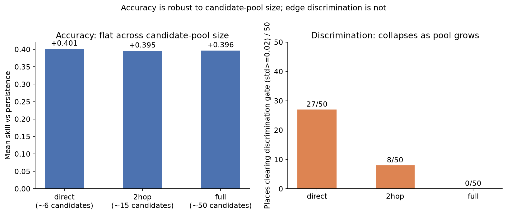

**Reading this chart:** the left panel shows forecast skill (how much
better than the naive baseline the model does) for each of the three
candidate-pool variants — it's essentially flat, ~0.40 regardless of pool
size. The right panel shows how many of the 50 regions produce a
*genuinely discriminating* set of edge scores (not just noise clustered
around one value) — and that number collapses hard as the pool grows.

**The full numbers, all 50 regions, 7-day-ahead forecasts, 5 training
epochs, out-of-sample test set (2013 onward):**

| candidate pool | ~how many candidates | regions that beat "tomorrow = today" | avg. skill vs. that baseline | avg. R² vs. climatology | regions with genuinely informative edge scores |
|---|---|---|---|---|---|
| **direct** (immediate neighbours only) | 6 | 50 / 50 (100%) | +0.401 | −0.014 | **27 / 50 (54%)** |
| **2hop** (neighbours of neighbours too) | 15–20 | 50 / 50 (100%) | +0.395 | −0.023 | 8 / 50 (16%) |
| **full** (every other region) | 50 | 50 / 50 (100%) | +0.396 | −0.020 | 0 / 50 (0%) |

(Source: `code/results/step7_all_places_direct_lead7.json`,
`step7_all_places_2hop.json`, `step7_all_places_full.json`. "Genuinely
informative" means a score standard deviation of at least 0.02 — below
that, scores are statistically indistinguishable from noise clustered
around one value.)

**Why this happens:** the splitter has one shared internal model that has
to score every candidate in the pool in a single pass. A small, fixed,
consistent pool (like `direct`'s handful of physical neighbours, the same
shape every time) is a much easier discrimination task than a pool of 50
similar-looking competing hypotheses all at once. It's a capacity
problem, not a training-time problem — training longer helps somewhat
(§10.2 below), but doesn't fully close the gap once the pool is large.

We confirmed this isn't just a real-data artifact by reproducing it on
the synthetic ground-truth test (once a scoring bug in it was fixed): with a large
synthetic candidate pool, the splitter's precision and recall for
finding the true causal parents we'd injected into the fake data dropped
sharply. Restricting the candidate pool down to a smaller, focused set
recovered meaningfully better precision and recall — a real but partial
fix, since a real number of true causal parents were still missed even
in that best case (full ladder of n=5/15/30/50 cluster counts:
`code/results/step3_semisynthetic_n5.json` through `_n50.json`).

**One direct attempt to fix the large-pool problem was tried and did not
work.** Given that the root cause looks like a capacity/dilution problem,
we tried ranking every candidate by its raw lagged correlation with the
target region and capping the pool down to only the top-K before handing
it to the splitter — artificially shrinking a large pool back down to a
small one. Tested on region 22 with the `full` pool (50 candidates)
capped down to 8 (matching `direct`'s typical size): the result was
*worse* than even the uncapped `full` pool, and far below `direct`'s own
discrimination quality. We also checked whether the problem was really
about candidate-pool *composition* (physically-adjacent regions vs.
regions merely selected by correlation) rather than raw count — but
`2hop`, a real, physically-coherent medium-sized pool, also fails to
clear the discrimination threshold, so composition alone doesn't explain
the gap either. The pool-size trend is real and reproducible, but
shrinking a large pool back down after the fact doesn't mechanically
reproduce the discrimination quality of a pool that was small from the
start. The capping capability is kept in the codebase
(`cap_candidate_source_set` / `rank_sources_by_lagged_correlation`, wired
in via `train_step4_single_place.py --max-candidates`, zero effect
unless explicitly turned on) for whoever picks up this question next.
This remains the clearest concretely-defined open problem in the project
— see §14.

**Practical consequence for anyone using this project's output:** if you
want to make a claim like "region X causally drives region Y," only
trust that claim when it comes from the `direct` variant. `2hop` and
`full` still forecast just as accurately, but their selected edges should
be treated as accuracy-only results, not reliable causal claims.

---

## 10. Results — forecast accuracy across all 50 regions

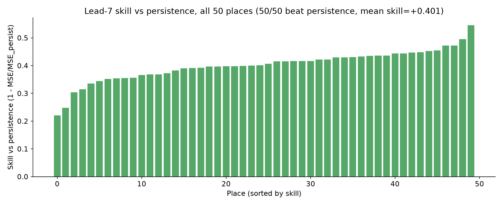

At a **7-day forecast horizon**, the model beats a naive "tomorrow =
today" baseline at **every single one of the 50 regions**, with skill
ranging from +0.22 to +0.55 (mean +0.40) — meaning the model's prediction
error is, on average, about 40% lower than just guessing that nothing
changes from today.

### 10.1 Why the forecast horizon (lead time) matters so much

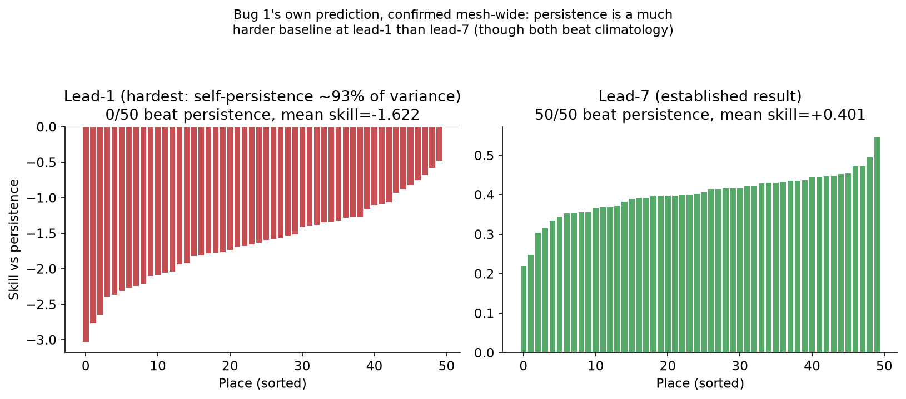

At a **1-day** forecast horizon, the picture flips completely: the model
beats the naive baseline at **0 of 50 regions** (average skill −1.622 —
the model's error is more than twice persistence's at this horizon).
This is not a failure of the model — it's because at 1 day ahead,
"today's value" is already such an extremely strong predictor (weather
barely changes day to day) that essentially nothing can beat it. Every
region still clearly beats climatology at this horizon (mean R² =
+0.729), so the model is genuinely skillful — just not more skillful
than the (very strong, at this specific horizon) naive baseline.

Edge discrimination is actually *better* at 1 day than at 7 days: 37 of
50 regions (74%) produce genuinely informative edge scores, vs. 27 of 50
at the 7-day horizon (§9). Forecast accuracy and discrimination quality
are measuring two different things and don't move together — this is the
clearest single piece of evidence for that in the whole project. (Source:
`code/results/step7_all_places_direct_lead1.json`.)

The honest way to read all this: the naive baseline is a genuinely very
hard bar at 1 day, and a much easier bar at 7 days, and the model's
relative performance against it should always be read together with
which lead time is being discussed.

**A separate baseline, for context:** the model is also compared against
"climatology" — simply predicting the long-term average value every day,
ignoring today's conditions entirely. At the 1-day horizon, the model
clearly beats climatology (mean R² = +0.73) even though it can't beat the
much harder persistence baseline there. At the 7-day horizon, the picture
is more mixed against climatology specifically — mean R² vs. climatology
is actually *negative* on average for all three candidate-pool variants
(−0.014 to −0.023; see §9's table) — while the model still cleanly
beats persistence. This is not a bug; it reflects how little short-range
structure OLR has left to exploit at 7 days relative to its own
day-to-day variance, which makes a constant climatology prediction a
genuinely strong competitor at that horizon.
**These are genuinely two different comparisons, and both should be
reported together, not just the flattering one:** "beats persistence" is
true and solidly established at 7 days; "beats climatology" is a
separate, much closer — and on average slightly losing — contest at that
same horizon.

### 10.2 Training budget matters too

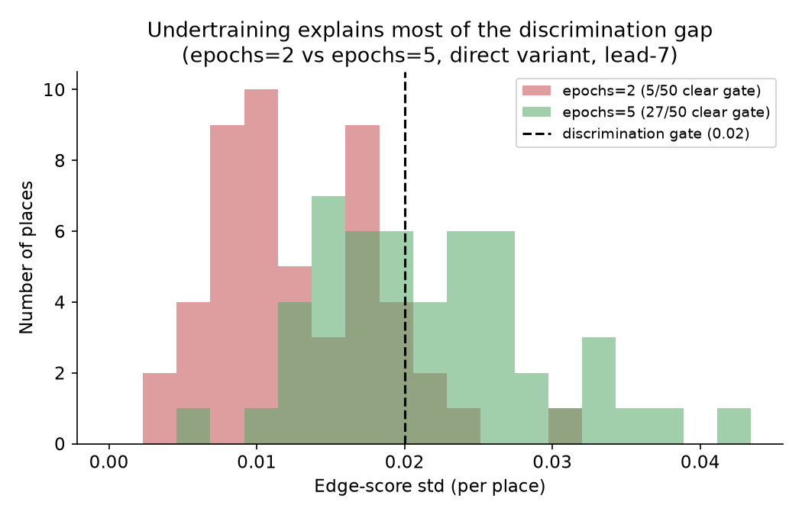

The discrimination-quality numbers above (§9) were measured after
training each region for 5 epochs. Training for only 2 epochs — half the
budget — cuts the number of regions clearing the discrimination-quality
bar roughly in half (from 27/50 down to 5/50), while forecast accuracy
barely changes. This is a useful, practical lesson: if you're evaluating
whether the causal-discovery mechanism is "working," make sure the model
was actually trained long enough first — an undertrained run can look
like a broken mechanism when it's really just undertrained.

---

## 11. Step 6: Adapting when the physics changes (Mixture-of-Experts)

Weather regimes shift over time. A relationship that held for years can
break down (an El Niño year behaves differently from a normal year), and
a model trained once and never updated will quietly get worse at exactly
the moments it matters most. This project addresses that with a
per-region model *lineage*, plus a way to detect when the lineage needs
to change.

### 11.1 Detecting that something has changed

Two independent "channels" watch for drift, and their signals are
combined:

```
┌──────────────────────────┐      ┌──────────────────────────────┐
│ Channel 1 — error-based    │      │ Channel 2 — causal-structure   │
│                              │      │ based                            │
│ Watches the expert's        │      │ Watches whether the PATTERN of  │
│ rolling forecast error       │      │ which edges the splitter scores │
│ for a sudden jump             │      │ highly is itself changing over  │
│                              │      │ time                             │
└──────────────┬───────────────┘      └───────────────┬──────────────┘
               │                                        │
               └───────────────┬────────────────────────┘
                                v
                    ┌───────────────────────┐
                    │  Combine the two          │
                    │  OR  --  react fast, more  │
                    │          false alarms       │
                    │  AND --  react slow, fewer   │
                    │          false alarms         │
                    └───────────┬───────────┘
                                v
              ┌─────────────────────────────────┐
              │  Decision                           │
              │  Tier 0: nothing has changed,       │
              │          keep the current expert     │
              │  Tier 1: retrain the current expert  │
              │          on recent data              │
              │  Tier 2: archive the current expert   │
              │          and bring in a new/different │
              │          one                          │
              └─────────────────────────────────┘
```

The error-based channel is `river.drift.ADWIN` over the expert's rolling
prediction error. The causal-structure channel is a from-scratch
implementation of the Rodionov/STARS (2004) regime-shift test, applied to
a causal-signature distance series.

**Why watch causal structure, and not just forecast error?** Forecast
error only tells you something is wrong *after* the model starts getting
worse. Watching the causal edge scores' own pattern can, in principle,
catch a genuine underlying shift in the physics *before* it necessarily
shows up as a worse forecast — a more forward-looking signal.

**Concrete example of the trade-off, measured on real test cases (an
abrupt shift — the 1997-98 El Niño — and a gradual, multi-year shift):**

| detector | catches the abrupt shift? | catches the gradual shift? |
|---|---|---|
| Error-based only | missed it | yes, but slowly |
| Causal-structure only | yes, quickly | yes |
| Combined with OR (either triggers) | yes, quickly | yes |
| Combined with AND (both must agree) | missed it | yes, but slowly |

This is a genuine trade-off, not a solved problem: reacting fast (OR)
means more false alarms; being conservative (AND) means missing some
real, fast-moving shifts. The project reports both rather than picking
one as "correct." (Source: `code/results/step5_drift_place22_direct.json`.)

This was re-run at two more regions (12 and 29 — not just 22), under the
same honest, out-of-sample evaluation conditions. Both detected both
test shifts across all signal/combination settings too, with
region-specific differences in how quickly — region 29's
causal-structure signal caught the gradual shift far faster than its
error-based signal did (117 days vs. 1,158 days). (Source:
`code/results/step5_drift_place12_direct.json`,
`step5_drift_place29_direct.json`.)

### 11.2 Archiving old experts and bringing them back

Instead of deleting an old expert the moment a new one is needed, retired
experts are archived. Since weather regimes recur (seasons, El Niño/La
Niña cycles), an old archived expert might be exactly the right fit again
later.

```
Region A:  Expert A-1 --[drift]--> Expert A-2 --[drift]--> Expert A-3 (ACTIVE)
                |                        |
          [hibernate]              [hibernate]
                v                        v
             Archive A  <---- searched on every future drift event
```

### 11.3 Single best match vs. blending several — a real, tested comparison

When a drift event fires and the system needs to bring in a replacement
expert, there are two ways to use the archive:

```
   drift event fires for Region A
              |
              v
   compute Region A's current "causal signature"
   (a summary of which edges it's currently scoring highly)
              |
              v
   compare against EVERY archived signature in the whole system
              |
       +------+---------------------+
       |                            |
  Variant A                    Variant B
  use the SINGLE best-           BLEND the top-3 best
  matching archived expert       matches together, weighted
                                  by how similar each one is
```

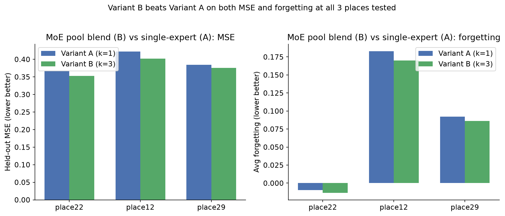

**Tested at three regions chosen to represent a spread of discrimination
quality (low, medium, high — regions 22, 12, 29), with a real training
budget, not a smoke test:**

| | region 22 | region 12 | region 29 |
|---|---|---|---|
| blended-pool (Variant B) beats single-best (Variant A) on forecast error | 30 of 49 cases (61%) | 42 of 61 cases (69%) | 41 of 61 cases (67%) |
| Variant B wins on "forgetting" (how much worse it does on a regime it's seen before) | **yes** | **yes** | **yes** |
| warm-starting a reactivated expert beats spawning a fresh one (forecast error) | 28 of 34 cases (82%) | mixed, no clear winner | 24 of 36 cases (67%) |
| warm-starting wins on "forgetting" | no | no | **yes** |

(Source: `code/results/step6_lifecycle_place22_direct.json`,
`step6_lifecycle_place12_direct.json`, `step6_lifecycle_place29_direct.json`.)

**Result:** blending the top-3 matching archived experts (Variant B)
beats using just the single best-matching one (Variant A) on both
forecast accuracy *and* "forgetting" — consistently, at every region
tested. This is one of the most solidly repeated findings in the whole
project.

**A second, easily-confused claim is genuinely weaker and shouldn't be
generalized:** whether *warm-starting* a reactivated expert (continuing
to train its existing weights, rather than spawning a brand-new one from
scratch) helps is region-dependent — it loses on the forgetting metric at
two of the three regions tested, and wins at the third. Don't state
"warm-starting helps forgetting" as a general finding; the narrower,
better-supported claim is just "the k=3 pool blend helps."

---

## 12. Putting it all together — the full pipeline

```
raw grid (3,600 cells)
        |
   [clustering] -> 50 regions, physical adjacency mesh
        |
   [windowing] -> 49 lagged features per region, per day
        |
        v
  +-----------------------------------------+
  |  per region, per time block:             |
  |    Splitter -> scores candidate edges     |
  |             -> picks the causal set c̃      |
  |    Expert trained on c̃                     |
  |    -> OLR forecast, N days ahead           |
  +-----------------------------------------+
        |
   [drift detection, two channels] --watches--> forecast error +
        |                                        causal-structure signals
   drift detected? -> retrain in place, or archive + bring in new/blended
        |
   repeated independently across all 50 regions
```

---

## 13. Phase 1: build, validate and use a causal graph

**The question:** can a causal graph, found statistically and checked
independently, improve how the splitter chooses its sources? Until now
the splitter found its own sources. Phase 1 instead builds a graph with
PCMCI, independently of the splitter. The graph is then checked four ways,
frozen, and handed to the splitter as a prior. The work has four stages:

| Stage | Question | Status |
|---|---|---|
| A. Build (PCMCI) | Which sources, at which lag, still carry information about the target once indirect paths and common drivers are removed? | **Done** |
| B. Validate (B1–B4) | Is the graph better than chance, physically possible, small enough, and stable? | **Done** |
| C. Use | Does the graph, used as a prior, help the splitter on 2013–2022? | **Code done and tested; no-prior baseline run; prior runs not yet run** |
| D. Keep current | Does the causal structure change over time? | **Done** (weak result, §13.5) |

All Phase 1 outputs are in `code/results/phase1/`.

### 13.1 Data: nodes, years, season

- **Nodes.** Each region has 6 fields (sst, h850, u200, pw, u850, olr), so
  50 × 6 = **300 nodes**. A node's series is the region mean of its cells,
  re-standardized over the discovery years. SST is averaged over ocean
  cells only.
- **Years.** **1979–2012** are used to build the graph (and train the
  models). **2013–2022 are held out** and used only for testing.
- **Season.** A BSISO index is computed from our own OLR and u850 data,
  following the recipe of Lee et al. (2013):
  - the domain is 10°S–30°N, 40–160°E (our grid stops at 30°N);
  - the trailing 120-day mean is removed;
  - a combined EOF of the two fields is fitted on May–October days of
    1979–2012 only;
  - the first two modes explain 11.2% and 7.7% of the variance (Lee et
    al. report about 10% and 7%).

  Each year's season runs from the first to the last stretch of at least
  20 days in which the 31-day mean amplitude exceeds 1, padded by 21 days
  at each end. That gives **208 days a year on average (82–286)**, with
  onset ranging from April to July. Only *target days* must fall in the
  season; source values can come from any day.

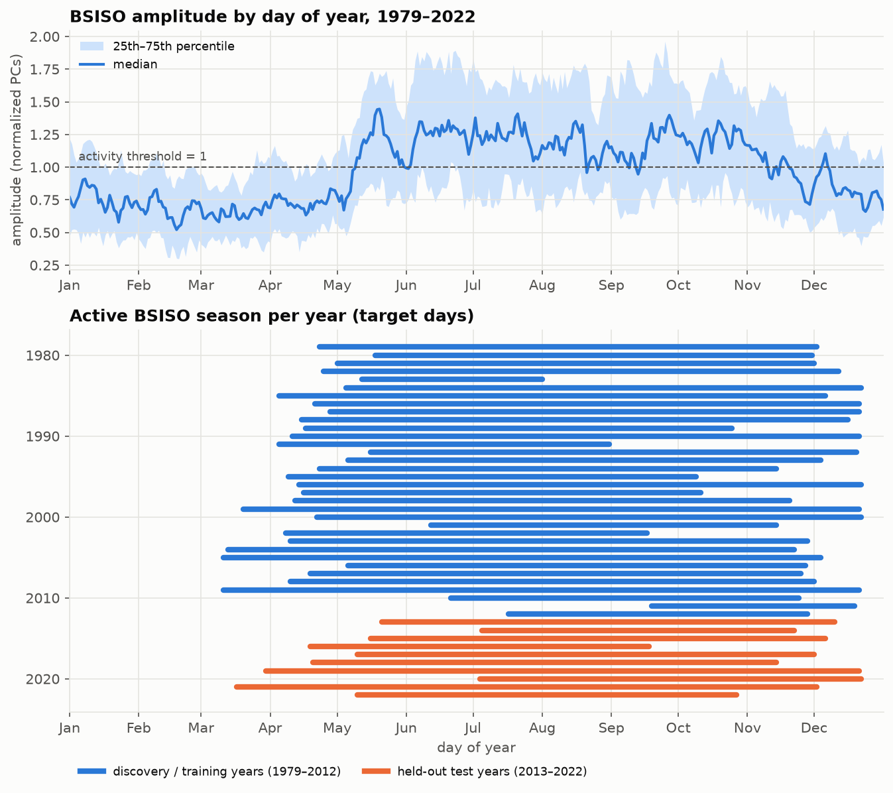

### 13.2 Stage A: PCMCI

For each of the 50 OLR targets, every one of the 300 nodes at every lag
from 1 to 60 days is a candidate. That is **18,000 candidates per
target**, tested on **7,153 season target days**. Lag 0 is excluded, so
the direction of each link comes from time order.

The method has two steps:
1. **PC1 screening.** Partial-correlation tests drop candidates that are
   independent of the target, conditioning on the strongest surviving
   candidates found so far.
2. **MCI final test.** Each survivor is retested while conditioning on the
   target's other parents and on the source's own parents. The p-values
   are then Benjamini–Hochberg corrected over all 18,000 tests, and a link
   is kept at an FDR of 0.05.

The settings are `pc_alpha` = 0.05, and other nodes may only take their
own past as parents. Calling tigramite directly at this size was too
slow, so `causal_moe/causal_graph/pcmci.py` is a vectorized version of
the same algorithm. `tests/test_pcmci.py` checks it link for link against
tigramite. The full run takes about 23 minutes.

**Result:** **536 significant links**, 10.7 per target on average.
- **376 are within the target's own region**, mostly its own OLR at
  lags 1–7.
- **160 come from other regions.** By field: OLR 72, u850 37, u200 22,
  h850 18, PW 11. There is no SST link from another region.
- **Outside links are short-lag:** median lag 1 day, 90% at 2 days or
  less, and none at 25 days or more. The direct effect of slow precursors
  (e.g. spring SST) appears to be absorbed once PCMCI conditions on
  short-lag parents.

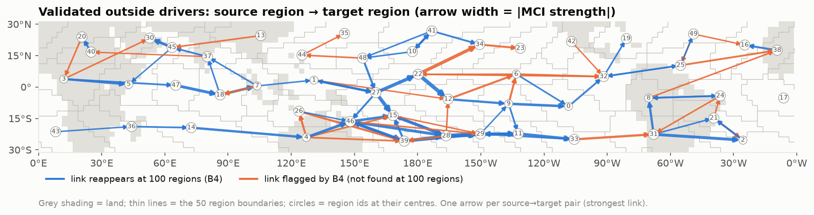

The outside links are mostly between neighbouring regions. A handful are
longer wind and height links (e.g. 22 → 32, 46 → 28, 8 → 38) that need
1–2 days at wave speeds.

Region 22 is the walk-through example:

| Step | Edges left | What happened |
|---|---|---|
| PCMCI | 13 | 10 within region 22 (own OLR at lags 1–3 and 5–7, u850 and h850 at lags 1–2), plus h850 from region 27 at lags 1 and 3, and PW from region 6 at lag 2 |
| B1 decoys | 13 | No decoy was selected anywhere, so there is no strength bar to clear |
| B2 lag mask | 13 | The outside sources are about 280 km away; implied speeds of 1–3 m/s are possible |
| B3 top-k | 3 drivers | The 3 outside links are kept; region 22's own links don't count against the budget |
| B4 persistence | score 0.67 | Both region-27 links reappear at 100 regions; the region-6 PW link does not and is flagged |

The prior given to the splitter is **region 27 (strength 0.21) and
region 6 (0.05)**. Trained on season days in the `direct` pool with no
prior, the splitter picks regions 6, 12 and 27 on its own. Both prior
regions are among them: two unrelated methods agreeing.

### 13.3 Stage B: four checks

| Check | What it does | Result |
|---|---|---|
| **B1 decoys** | 250 decoys made by phase-randomizing real node series. Each keeps its spectrum, including the 30–60-day peak, but has no real link to anything. PCMCI is run with them in the pool (550 nodes, 33,000 candidates per target), as a separate pass. | **0 of 250 decoys selected** (gate: under 30%). The real graph in this pass barely changes (10.3 vs 10.7 links per target). With no selected decoy, there is no strength threshold, so B1 removes no real edge. |
| **B2 lag mask** | Implied speed = shortest cell-to-cell distance between the two regions ÷ lag. Generous limits per source field: SST 1 m/s; OLR and PW 20 m/s (coupled Kelvin waves); h850, u850 and u200 50 m/s. Lags of 25 days or more are flagged as possible echoes of the oscillation, not dropped. | **3 of 536 links fail**, all at lag 1: h850 region 22 → 32 (5,531 km, 64 m/s), OLR 28 → 33 (2,889 km, 33 m/s) and OLR 3 → 47 (2,215 km, 26 m/s). Of the links kept, 28 outside links span 500–5,500 km. The fastest is 46 m/s, from wave-like wind and height links. No link reaches the 25-day flag. |
| **B3 top-k** | Rank each target's outside links by strength and keep k. k is chosen by how well a target's own-region links plus its top-k outside links predict the target on 2005–2012 season days, after fitting on 1979–2004. | Validation R² rises with every k: 0.9619 at k=0 to 0.9633 at k=10. So **k = 10**, which equals the largest number of outside links any target has. **B3 cuts nothing**: PCMCI with FDR is already sparse, at **2.06 prior regions per target**. 2 targets (13 and 42) have no outside driver. |
| **B4 resolution** | Each region is split in two (100 regions, 596 nodes) and Stage A is run again. A link persists if any child pair carries the same field within ±2 days of the same lag. | **Mean persistence 0.62; 33 of 48 targets pass** (≥ 0.50). By field, OLR links persist best (56 of 70) and PW links worst (4 of 11). Links that fail are flagged, not deleted. |

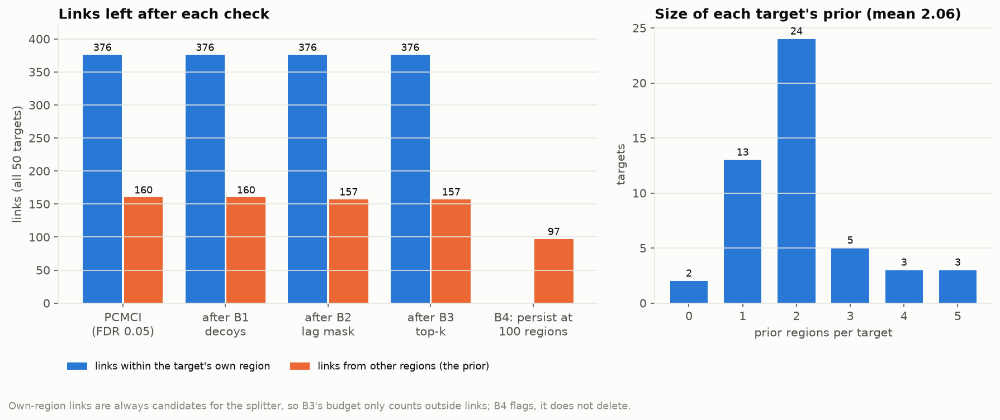

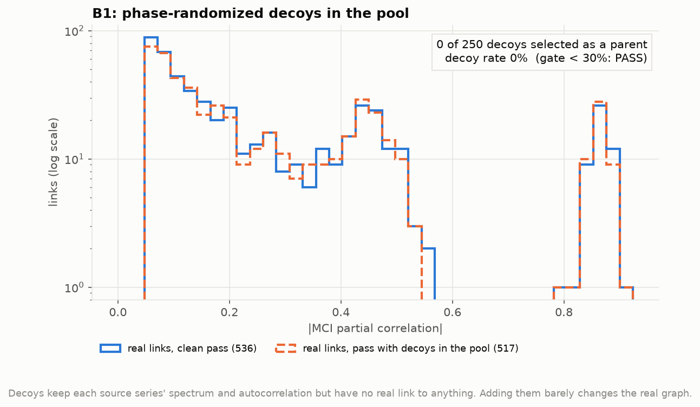

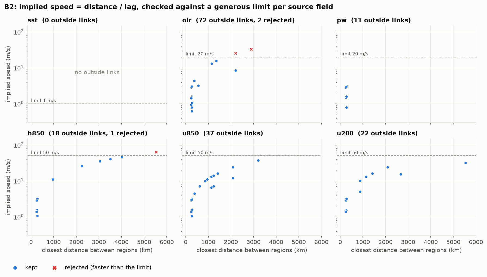

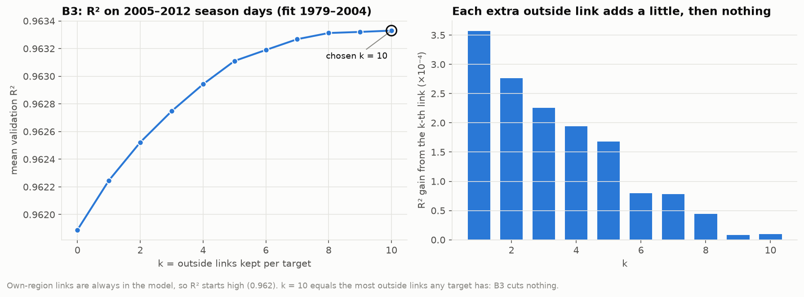

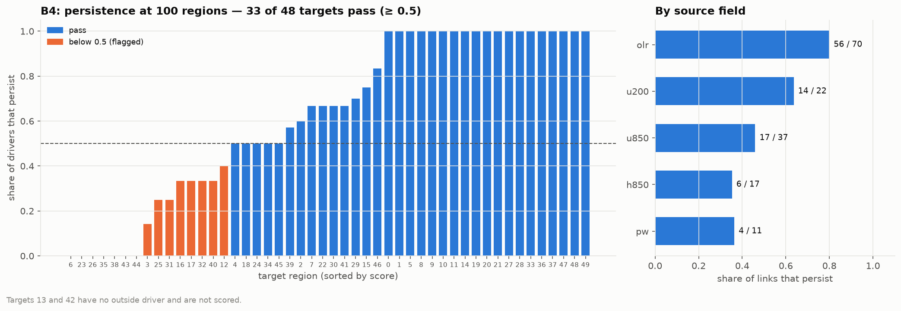

The frozen graph, with every flag, is in
`results/phase1/causal_graph_50.json`. For each target it holds the
validated links (source region, field, lag, strength, distance, speed,
flags), plus the region-level `prior` that goes to the splitter.

**Field and lag detail stay in the graph, not the splitter.** Each of the
splitter's candidate edges is a whole source region carrying lags 0–10.
So a target's validated links are merged into one prior per region,
whose strength is the largest |MCI value| among that region's links.

### 13.4 Stage C: the graph as a splitter prior

**Implemented** in `causal_moe/causal_graph/prior.py`, plus small hooks
in the splitter and the training scripts. All of it is off by default,
so earlier results reproduce unchanged. There are three ways to give the
prior to the splitter:

- **restrict** — the candidate pool becomes the prior regions plus the
  target itself.
- **initialize** — a learnable bias is added to each edge's score, so a
  prior region starts with a score boost proportional to its strength.
- **regularize** — a penalty is added on the scores of regions outside
  the prior.

And three priors to compare:

- **pcmci** — the validated graph above.
- **random** — the same number of regions per target, drawn at random
  from the same pool. The PCMCI strengths are shuffled onto them.
- **corr** — the same number of regions, ranked by raw lagged
  correlation on training rows only. This is the prior that already
  failed as a pool cap in §9.

The target region is always a candidate and is never biased or
penalized.

**Baseline run on season days (no prior)**, with the same settings as
§9 (5 epochs, 4,000-sample training cap) and testing on the 1,989
season target days of 2013–2022:

| Candidate pool | Edge scores informative | Beat persistence | Mean skill vs persistence | Beat climatology | Mean R² vs climatology |
|---|---|---|---|---|---|
| direct | **30 / 50** | 50 / 50 | +0.412 | 15 / 50 | −0.020 |
| 2hop | 9 / 50 | 50 / 50 | +0.413 | 18 / 50 | −0.018 |
| full | 0 / 50 | 50 / 50 | +0.415 | 14 / 50 | −0.015 |

(Source: `results/phase1/stage_c/{direct,2hop,full}_none.json`.) This is
the same pattern as the year-round results in §9:
- edge-score discrimination falls as the pool grows;
- skill against persistence is flat;
- the model still loses to climatology on average at 7 days.

**Not yet run: the 27 prior configurations** (3 priors × 3 modes × 3
pools, at 50 regions each), because of compute. That is 1,350
trainings, about 6–8 hours on 12 worker processes. To run them
(the script resumes if stopped):

```bash
cd code
python scripts/phase1_run_stage_c.py --workers 12
# a cheaper first step, matching the plan's advice to run the
# random-prior control before anything else:
python scripts/phase1_run_stage_c.py --pools full --priors random,pcmci --modes restrict
```

**Things to keep in mind when reading those runs:**

- **In initialize mode, the prior bias itself spreads the edge scores.**
  That alone can push a region past the "informative" threshold. Compare
  initialize-mode runs with the random prior of equal size, not with the
  no-prior run.
- **The graph's outside links are 1–2-day links, but the forecast is 7
  days ahead.** The prior says *which regions* matter, but the
  relationships PCMCI found act faster than the forecast horizon.

### 13.5 Stage D: does the causal structure change over time?

For each target, PCMCI is rerun on sliding windows of BSISO seasons. Each
window uses only that target's links that passed B1 and B2, plus its own
OLR at lags 1–3. A window's parent set is its significant (source region,
field) pairs. The distance between consecutive windows is
1 − Jaccard(parent sets). That series goes into the project's existing
Rodionov/STARS test for regime shifts.

To compare with ENSO, a Niño-3.4 index is computed from our SST field:
5°S–5°N, 170°W–120°W, season mean, trend removed. El Niño is > +0.5 SD
and La Niña is < −0.5 SD. It matches the known ENSO phase in 22 of 24
labelled years; 1989 and 2008 are wrong.

| Window | Parents per window | Distance when ENSO phase changed vs when it didn't | Alarms from the 50-target average | Per-target alarms |
|---|---|---|---|---|
| 1 season | 1.1–1.3 | 0.164 vs 0.151 (Mann–Whitney p = 0.20) | 2004, 2011, 2016 | 55 alarms. 76% fall in years with a phase change, but 67% of all years have one. 13 fall in stable years. |
| 3 seasons | 1.6–2.0 | 0.200 vs 0.207 (p = 0.76) | none | 21 alarms. 43% fall in phase-change years; 12 in stable years. |

(Source: `results/phase1/stage_d_drift_w{1,3}.json`.)

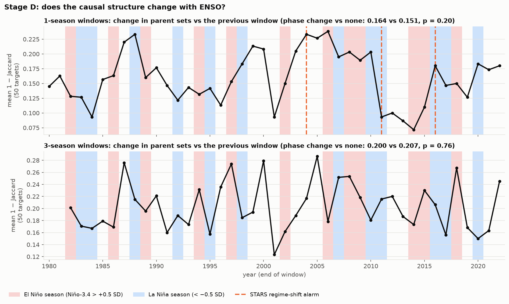

**What this shows:** at these window lengths, changes in the causal
structure do **not** reliably line up with ENSO phase changes. With only
1–2 parents per window, the parent set is mostly the target's own OLR
plus whichever outside link clears FDR in that window. Sampling noise
dominates.

One alarm, 2016, does coincide with the 2015–16 El Niño ending, but that
is a single case. As built, this signal is **not yet good enough to
drive the expert lifecycle**. Longer windows with a rolling reference,
or a softer distance (comparing strengths instead of set membership),
are the obvious next things to try.

### 13.6 Phase 1 so far

- **The graph passes the checks that test whether a graph is
  trustworthy:**
  - no decoy is selected;
  - only 3 links need a physically impossible speed;
  - 62% of links persist when the regions are redrawn at twice the
    resolution;
  - for region 22, both prior regions are among the splitter's own
    selections.
- **The graph is sparse, short-lag and mostly local:** about 2 outside
  regions per target, at lags of 1–2 days.
- **Not answered yet: does the prior help the splitter on 2013–2022?**
  That needs the Stage C runs above.
- **The plan says to run the random prior first.** If a random prior of
  the same size matches the PCMCI prior on edge-score discrimination
  and skill, the bottleneck is not which sources the splitter chooses,
  and the splitter's objective should be revisited instead.

---

## 14. Current limitations, stated plainly

- **Causal-discrimination reliability depends heavily on candidate-pool
  size** (§9) — trustworthy for `direct`, not for `2hop`/`full`. One
  direct fix attempt (capping the pool by correlation) didn't work (§9)
  — this is the clearest, most concrete next step for anyone continuing
  this project.
- **No independently verified ground truth exists for real climate
  causal relationships** (§7.1) — every causal claim in this project
  rests on the three indirect checks described there, not on a known
  correct answer.
- **Direct comparison against other published Mixture-of-Experts methods
  from the wider research literature has not been done.** The
  comparisons in this document are all internal (persistence, plain-GNN,
  random-subset, CIA, GSINA — see §7.2 and the `simple.py` baselines
  below). See §2 for which published methods this project is
  conceptually built on vs. actually benchmarked against.
- **Published baseline methods referenced in early planning (GC-MoE,
  GeoMoE, DyMoE) were never actually run as head-to-head comparisons**
  (§2) — don't present them as having been tested. The only baselines
  actually run are the internal ablations in
  `code/causal_moe/baselines/simple.py`
  (`code/results/step8_baselines_place22_direct.json`): persistence, a
  plain GNN using every candidate edge with no selection, and a random
  fixed-size edge subset. That results file is a short smoke test (1
  epoch, 200 samples, 1-day lead), not a full comparison.
- **At 7 days the model does not beat climatology on average** (mean
  R² vs climatology is about −0.02 in both the year-round and the season
  runs). "Beats persistence" is a low bar at 7 days, because OLR keeps
  almost no memory over a week.
- **Phase 1's causal prior has not yet been tested in the forecaster**
  (§13.4). The graph has been built and validated, and the code to use
  it is written and tested, but the comparison runs are still pending.
- **Phase 1 graph caveats** (§13):
  - **Statistical power.** 18,000 candidates per target on strongly
    autocorrelated daily data means some links will be missed and some
    will be false, even after FDR.
  - **Hidden common drivers.** PCMCI assumes all common drivers are
    measured. BSISO phase, ENSO and moisture are only partly captured.
  - **Unstable field choice within a region.** The fields in one region
    move together with the same wave, so which field PCMCI picks can
    change between runs.
  - **Partly circular regions.** The regions were built from OLR
    correlation and are then used to find OLR links.
  - **Climatology overlaps the test years.** The upstream anomaly
    climatology was fitted on 1979–2014, which overlaps the 2013–2022
    test years by two years.
  - **No second data source.** The graph has not been checked against a
    second reanalysis or another OLR product.
  - **Short lags vs the forecast lead.** The outside links found are
    1–2-day links, shorter than the 7-day lead.
- **The Phase 1 drift signal is weak** (§13.5). Changes in the causal
  structure between seasons do not reliably track ENSO phase changes.

---

## 15. Code map

All code lives under `code/`.

```
code/
├── causal_moe/                  the actual library
│   ├── data/
│   │   ├── raw.py               loads the 6 fields + ocean mask
│   │   ├── clustering.py        k-means -> 50 regions (§4)
│   │   ├── mesh.py              physical adjacency (raw cells + regions)
│   │   ├── windows.py           49-value lagged features, OLR-N-days target (§5)
│   │   ├── splits.py            chronological train/val/test split +
│   │   │                        El Niño / gradual-drift test windows
│   │   ├── candidate_edges.py   direct / 2hop / full candidate-pool variants (§6)
│   │   ├── causaldynamics.py    loads validation data with known causal graphs
│   │   └── semisynthetic.py     real features + a hand-injected, known causal
│   │                            rule (the synthetic ground-truth test, §9)
│   ├── splitter/
│   │   ├── dirgnn.py            the causal splitter (§7)
│   │   ├── cia.py               an alternative edge-selection mechanism (§7.2)
│   │   └── gsina.py             an alternative edge-selection mechanism (§7.2)
│   ├── experts/
│   │   ├── expert.py            the forecaster (§8)
│   │   └── pool.py              the Mixture-of-Experts blending router (§11.3)
│   ├── causal_graph/            Phase 1 (§13)
│   │   ├── season.py            BSISO index + per-year active season
│   │   ├── nodes.py             300 (region, field) series, 100-region split,
│   │   │                        region distances
│   │   ├── pcmci.py             Stage A: PCMCI (PC1 + MCI, ParCorr, BH-FDR)
│   │   ├── validate.py          Stage B: decoys, lag mask, top-k, persistence
│   │   └── prior.py             Stage C: pcmci / random / corr priors and
│   │                            restrict / init / regularize modes
│   ├── drift/
│   │   ├── rodionov.py          the change-point statistical test (§11.1)
│   │   ├── channels.py          both drift channels + how they're combined (§11.1)
│   │   ├── archive.py           the hibernate/reactivate store (§11.2)
│   │   └── forgetting.py        the "how much did we forget" metric
│   └── baselines/simple.py      persistence / plain-GNN / random-subset comparisons (§14)
├── scripts/                      one runnable script per experiment
├── tests/                        150 automated tests, all passing (the
│                                 CausalDynamics test also needs xarray
│                                 and its external data)
├── cache/                        preprocessed data (regenerable, not stored in git)
└── results/                      every experiment's numeric result, plus
    ├── phase9_figures/            the charts embedded in this document
    └── phase1/                    Phase 1 graph, checks, Stage C/D results
```

Phase 1 scripts: `scripts/phase1_build_graph.py` (Stages A–B),
`scripts/phase1_run_stage_c.py` (Stage C grid),
`scripts/phase1_stage_d_drift.py` (Stage D),
`scripts/generate_phase1_figures.py` (§13 figures). Stage C reuses
`train_step4_single_place.py` / `run_step7_all_places.py`, which gained
`--season-path`, `--prior`, `--prior-mode`, `--workers` and `--out`.
All of these are off by default.

**Reference implementations used** (real published code, not
reimplemented from scratch): the causal-splitter mechanics come from
[Wuyxin/DIR-GNN](https://github.com/Wuyxin/DIR-GNN) (Wu et al., ICLR
2022); the independent causal cross-check uses
[tigramite](https://github.com/jakobrunge/tigramite)'s PCMCI algorithm
(Phase 1 uses a vectorized version of the same algorithm, tested
against tigramite);
the known-ground-truth validation data comes from
[kausable/CausalDynamics](https://github.com/kausable/CausalDynamics).

---

## 16. Running it yourself

### 16.1 Environment

Python 3.12 with the pinned requirements (CPU-only PyTorch) plus
tigramite (used by the PCMCI test). The dataset is read from
`data/raw/rt_preprocessed_archive/` (or a legacy `Dataset/` folder next
to `code/`).

```bash
uv venv .venv --python 3.12        # or: python -m venv .venv
uv pip install --python .venv/bin/python -r code/requirements.txt tigramite
cd code
../.venv/bin/python -m pytest tests -q --ignore=tests/test_causaldynamics.py
```

### 16.2 Reproducing the headline numbers

All commands below run from inside `code/`. Build the 7-day cache
first (`code/cache/` is not in git):

```bash
python scripts/build_mesh_cache.py --lead-time-days 7
```

```powershell
# 50-region sweep, direct variant, 7-day horizon, honest out-of-sample
# evaluation, 5 training epochs (this is the main citable result, §9-10)
python scripts/run_step7_all_places.py --variant direct --epochs 5 `
    --n-samples-cap 4000 --cache-path cache/windowed_clustered50_lead7.npz `
    --generator-window 10
# -> results/step7_all_places_direct_lead7.json

# Same sweep, with the 2hop and full candidate-pool variants (the
# pool-size vs. discrimination-quality comparison, §9)
python scripts/run_step7_all_places.py --variant 2hop --epochs 5 `
    --cache-path cache/windowed_clustered50_lead7.npz
python scripts/run_step7_all_places.py --variant full --epochs 5 `
    --cache-path cache/windowed_clustered50_lead7.npz

# 1-day-horizon sweep (the hardest case, §10.1)
python scripts/run_step7_all_places.py --variant direct --epochs 5 `
    --cache-path cache/windowed_clustered50_lead1_v2.npz

# CIA / GSINA re-verification, region 22 (matches the plain splitter's
# settings exactly, for a fair comparison -- §7.2)
python scripts/train_step_cia_single_place.py --target 22 --variant direct `
    --epochs 5 --n-samples-cap 4000 --cache-path cache/windowed_clustered50_lead7.npz
python scripts/train_step_gsina_single_place.py --target 22 --variant direct `
    --epochs 5 --n-samples-cap 4000 --cache-path cache/windowed_clustered50_lead7.npz

# Mixture-of-Experts comparison: single-best-match vs. blended-pool,
# and warm-start vs. fresh-spawn (§11.3; needs the drift
# signal file for the target region first, from run_step5_drift.py)
python scripts/run_step5_drift.py --target 22 --variant direct `
    --cache-path cache/windowed_clustered50_lead7.npz
python scripts/run_step6_lifecycle.py --target 22 --variant direct `
    --gen-epochs 3 --eval-days 60 --cache-path cache/windowed_clustered50_lead7.npz

# Regenerate all the figures embedded in this document (pure plotting
# from existing results, no training)
python scripts/generate_phase9_figures.py
# -> results/phase9_figures/*.png
```

### 16.3 Phase 1

```bash
# Stages A + B: season, PCMCI at 50 regions, decoy pass, PCMCI at 100
# regions, validation -> results/phase1/causal_graph_50.json
# (about 2.5 h on 20 threads; each stage can be rerun alone with --stages)
python scripts/phase1_build_graph.py --verbose

# Stage C: the no-prior baseline on season days (done, ~1 h on 5 workers)
python scripts/phase1_run_stage_c.py --workers 5 --priors none
# Stage C: the full prior grid (not yet run, ~6-8 h on 12 workers; resumes)
python scripts/phase1_run_stage_c.py --workers 12

# Stage D: sliding-window causal-structure distance + STARS + ENSO check
python scripts/phase1_stage_d_drift.py --window-seasons 1
python scripts/phase1_stage_d_drift.py --window-seasons 3

# Figures for §13 (plots saved results only, ~1 min)
python scripts/generate_phase1_figures.py   # -> results/phase1/figures/*.png
```
